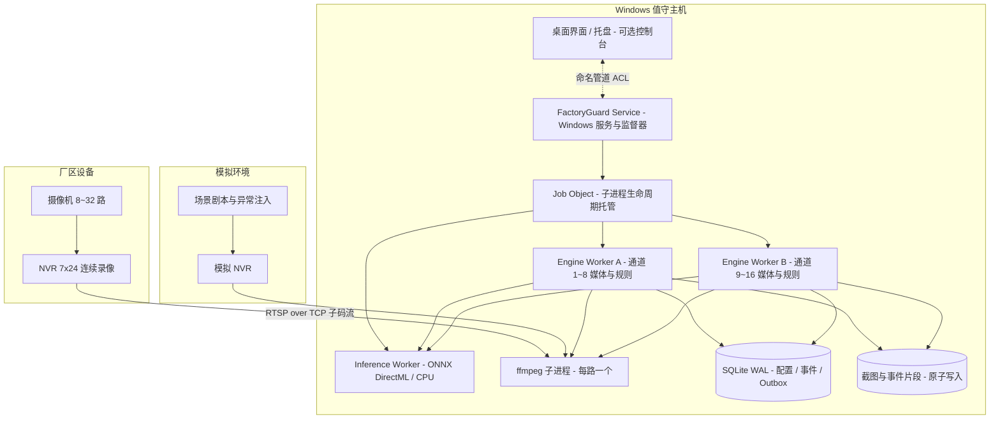
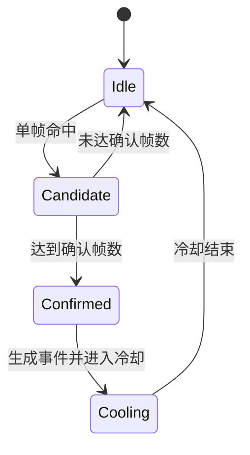

# 厂区智防平台（FactoryGuard）设计报告

---

# 第一部分 行业市场调研结果

## 1. 调研方法与数据口径

本部分回答三个问题：行业是否值得进入、目标客户是谁、系统应做成什么形态。结论用于直接导出第二部分的系统目标与边界。

| 维度 | 说明 |
| --- | --- |
| 数据来源 | 公开行业研究与咨询报告、上市安防企业年报与半年报、国家统计口径公开数据、行业协会公开信息、公开标准与主流厂商技术文档 |
| 统计口径 | 行业规模按设备出货与项目口径估算，不同报告是否含软件与集成服务会导致口径不可比 |
| 数据性质 | 本报告引用的数值均为**公开口径约数**，用于判断量级与趋势，不作为精确测算依据 |
| 时效性 | 行业数据通常存在 1～2 年披露滞后，实施前必须按最新公开数据复核 |
| 调研范围 | 中国大陆中小制造企业厂区，典型 8～32 路摄像机、1～2 台 NVR 的本地化视频智能检测场景 |
| 估算方法 | 由公开主体数量、单点可服务价值与渗透率推算 TAM/SAM/SOM 量级区间 |

**结论先行**：行业硬件存量已饱和，价值正从摄像机转向算法与软件平台；中小制造厂区是被头部方案忽略的长尾市场；最优切入点是"复用存量 NVR、本地运行、低误报、可闭环、可自愈"。

## 2. 视频监控与 AI 安防行业概况

### 2.1 市场阶段与规模

行业已进入"存量设备 + 智能化改造"阶段，增量主要来自 AI 算法与软件，而非摄像机数量本身。

| 观察项 | 公开口径约数 | 判断 |
| --- | --- | --- |
| 全球视频监控市场规模 | 约数百亿美元/年量级 | 存量庞大，纯硬件出货增长趋缓 |
| 中国安防行业总产值 | 约 8000～10000 亿元人民币/年量级 | 全球主要生产与消费市场之一 |
| 智能视频分析相关市场增速 | 明显高于硬件出货增速 | 价值向算法与软件迁移 |
| 新出货摄像机智能化比例 | 持续上升 | 前端 AI 与后端 AI 长期并存 |
| 行业整体增速 | 中低个位数到两位数区间 | 重心由"增量建设"转向"存量改造" |

### 2.2 增长动力

1. **安全生产与合规监管**：厂区与园区对重点区域管控有持续要求。
2. **人工值守成本上升**：夜间与节假日值守人力成本高、稳定性差。
3. **算力与模型成本下降**：本地 ONNX 推理与通用目标检测模型成熟，使中小规模场景自建智能检测具备可行性。
4. **存量设备复用意愿**：客户已建成基础监控，希望不更换设备即可获得智能告警。
5. **数据本地化要求**：隐私与合规顾虑推动分析能力下沉到本地。

### 2.3 智能化趋势

| 趋势 | 表现 |
| --- | --- |
| 从"移动侦测"到目标级识别 | 由像素变化判定升级为人/车/非机动车等目标识别 |
| 从"看得见"到"看得懂、能闭环" | 关注事件是否被确认、处置、取证 |
| 从集中云到边缘/本地 | 受带宽、时延与合规约束，推理下沉 |
| 从一次性项目到可配置服务 | 交付形态转向规则可配置、运行可运维 |
| 大小模型分工 | 轻量模型负责实时判定，大模型负责复核与检索 |

## 3. 产业链分析

| 环节 | 代表角色 | 核心价值与壁垒 | 与本系统的关系 |
| --- | --- | --- | --- |
| 芯片 / 算法 | 视觉芯片厂商、AI 算法公司 | 算力、模型精度、工具链与授权 | 提供可替换的推理后端与检测模型 |
| 设备 / NVR | 摄像机与 NVR 厂商 | 硬件渠道、协议兼容、稳定性 | 本系统复用 NVR 录像，只做检测与闭环 |
| 平台 | VMS / 综合安防平台 | 多设备纳管、行业功能、可扩展性 | 大型平台面向大客户，中小客户覆盖不足 |
| 集成商 | 工程与集成服务商 | 本地交付与现场服务 | 本系统降低配置与运维门槛，减少人工环节 |
| 终端客户 | 园区、工厂、企业 | 付费意愿取决于风险与损失规避 | 中小制造企业是关键细分市场 |

产业链判断：设备与平台环节高度集中，中小客户在其投资回报与交付成本模型中优先级偏低，形成明显的长尾供给空白。

## 4. 目标细分市场

### 4.1 客户定义

目标客户为**小公司厂区**，典型规模：**8～32 路摄像机、1～2 台 NVR、1 台 Windows 值守电脑**。

### 4.2 典型特征

- 已建成基础视频监控，通常以 7×24 连续录像为主，缺少实时智能告警；
- 无专职 IT 运维团队，依赖集成商或设备厂商远程支持；
- 预算敏感，倾向复用现有摄像机与 NVR，不愿新增专用服务器；
- 关注点集中在围墙、仓库、装卸区、车间入口等少数关键区域；
- 对误报容忍度极低，宁可少报也不接受无效告警淹没；
- 值守人员计算机水平有限，要求开箱可用、状态直观。

### 4.3 容量推算（TAM / SAM / SOM）

以下为按公开数据推算的**量级区间**，非精确测算，实施前需用最新公开数据复算。

| 层级 | 口径 | 公开口径约数 |
| --- | --- | --- |
| TAM（总体市场） | 中国大陆视频监控相关市场规模 | **千亿元人民币/年量级** |
| SAM（可服务市场） | 中小制造企业厂区（8～32 路规模） | 主体数量**百万级**，可服务市场规模**百亿元人民币/年量级** |
| SOM（可获得市场） | 复用现有 NVR、以软件形式交付的智能化改造份额 | 早期可达**数十亿元人民币/年量级** |

推算逻辑：

1. 中小制造企业与中小园区主体数量为百万级；
2. 按单厂区 8～32 路规模，单点软件可服务价值为**数千元/年量级**；
3. 以较低的早期渗透率（千分之几量级）测算，即得到 SOM 的数十亿元/年量级。

## 5. 需求变化趋势

| 趋势 | 客户表现 | 对系统的设计要求 |
| --- | --- | --- |
| 从录像到事件 | 客户要"发生了什么"，不满足于"有录像" | 事件中心、状态流转、可追溯取证 |
| 从人工监看到自动告警 | 值守人力成本高、夜间难保障 | 实时检测与自动通知闭环 |
| 低误报优先 | 无效告警导致系统被弃用 | 多帧确认、冷却去重、几何约束、硬负例抑制 |
| 数据本地化 | 隐私与合规顾虑 | 本地推理、本地存储、敏感信息脱敏 |
| 复用存量设备 | 不愿更换摄像机与 NVR | 基于 RTSP 子码流接入，不改动录像链路 |
| 可运维 | 缺少专职运维 | 健康监测、一键诊断、故障自愈 |

## 6. 竞争格局与供给空白

| 供给方 | 优势 | 中小制造厂区的空白 |
| --- | --- | --- |
| 头部安防厂商 | 设备与平台一体、渠道强、稳定性高 | 方案偏重、成本高、定制周期长 |
| 云视频 / AI 厂商 | 算法强、产品体验好 | 依赖云与带宽、存在数据合规顾虑 |
| 工程集成商 | 本地交付能力强 | 缺少软件化产品，交付依赖人工项目 |
| 开源 / 自建方案 | 成本低、可定制 | 缺乏可靠性与闭环，长期维护困难 |
| 智能盒子（边缘设备） | 部署简单 | 算力受限、功能固定、难以按园区规则深度定制 |

**供给空白**：面向中小制造厂区、复用现有 NVR、在普通 Windows 电脑本地运行、低误报、具备处警闭环与故障自愈能力的软件化产品明显不足。

## 7. 用户痛点

| 痛点 | 现状 | 客户期望 |
| --- | --- | --- |
| 只看不判 | 录像只在事后调取，事中发现依赖人眼 | 事中实时告警 |
| 误报泛滥 | 移动侦测受光影、天气、动物、飞虫干扰 | 稳定事件与可追溯证据 |
| 值守依赖人 | 夜间与节假日无人持续看屏 | 自动通知到人并确认 |
| 系统不稳 | 进程崩溃、断流、磁盘写满无人发现 | 自恢复且状态可见 |
| 定位困难 | 有告警也难从海量录像中找到对应片段 | 通道 + 精确时间定位 |
| 维护成本高 | 无专职人员，配置一处错误即失效 | 一键诊断、配置校验、易用界面 |

## 8. 调研结论

1. 行业价值正从硬件向算法与软件平台迁移，中小制造厂区是被大型平台忽略的长尾市场，竞争强度相对可控。
2. 客户已在位摄像机与 NVR，最优切入方式是"**复用存量、增强智能、本地运行**"，而不是替换设备或上云。
3. 决定客户是否长期使用的关键不是模型精度本身，而是**低误报、可闭环、可自愈、可运维**四项能力。
4. 由此确定系统方向：以 Windows 后台服务为核心，接入 NVR 的 RTSP 子码流，实现实时目标检测、区域入侵规则判定、事件与处警闭环，并内置模拟环境与故障自愈能力。以下第二部分给出该系统的完整设计。

---

# 第二部分 软件系统设计

## 9. 系统目标、范围与边界

### 9.1 系统目标

在**普通 Windows 电脑**上，对 8～32 路摄像机（RTSP 子码流）进行本地实时目标检测与区域入侵判定，形成"检测 → 告警 → 处警 → 取证"闭环，并具备故障自愈与可诊断能力。

### 9.2 系统范围

| 领域 | 内容 |
| --- | --- |
| 设备接入 | NVR 通道批量接入、子码流探测、通道状态与能力管理 |
| 媒体管线 | RTSP over TCP 拉流、解码、抽帧、环形帧缓冲 |
| 智能检测 | 本地 ONNX 推理（DirectML / CPU），目标级检测（person/car/truck） |
| 规则引擎 | 多边形电子围栏、绊线、方向判定、布防时间表、多帧确认、冷却去重 |
| 事件闭环 | 事件中心、截图、事件片段、NVR 定位、状态流转、误报反馈 |
| 通知联动 | Webhook 多渠道通知、重试、熔断、离线补偿与升级 |
| 运行可靠性 | Windows 服务、监督器、看门狗、崩溃重启、降级与恢复 |
| 可观测性 | 健康指标、结构化日志、一键诊断包、审计 |
| 模拟环境 | 模拟 NVR、虚拟点位、场景剧本、异常注入 |

### 9.3 与 NVR 的职责划分

| 能力 | NVR | FactoryGuard |
| --- | --- | --- |
| 7×24 连续录像 | **负责（权威）** | 不负责 |
| 视频流提供 | 提供 RTSP 主/子码流 | 消费子码流 |
| 实时智能检测 | 不依赖 | **负责** |
| 告警与通知 | 部分设备内置 | **负责** |
| 事件短片段 | 无 | 保存告警前 10 秒、后 20 秒 |
| 事后取证 | 提供完整录像回溯 | 事件精确定位到 NVR 通道与时间 |
| 平台级联 | 可选 | GB/T 28181 仅作**后续预留方向** |

### 9.4 明确边界

- 首版取流采用 **RTSP 子码流**；主码流仅用于必要时取证，不参与实时检测。
- GB/T 28181 只保留接入网关的接口方向，不在首版实现。
- 首版不做：云端集中部署、多租户、移动端 App、云台高级控制、多厂区集团管理。
- 系统不承担现场施工、设备选型替换与录像存储职责。

## 10. 用户角色与业务场景

### 10.1 用户角色

| 角色 | 职责 | 权限要点 |
| --- | --- | --- |
| 系统管理员 | 安装、账号、NVR 与通道、模型、存储、升级 | 全量配置与审计查看 |
| 布防管理员 | 绘制规则、配置时间表、布撤防 | 规则与布防配置 |
| 值守 / 接收人 | 接收告警、确认、判定误报、关闭事件 | 事件处置，不可修改系统配置 |
| 审计 / 维护 | 查看审计、导出诊断包 | 只读与诊断导出 |

### 10.2 业务场景

1. **围墙入侵**：布防时段内有人进入电子围栏 → 多帧确认 → 生成事件 → 截图与片段 → 通知 → 值守确认 → 定位 NVR 录像。
2. **硬负例干扰**：动物、树影、飞虫经过关键区域 → 不产生正式事件，但记录诊断信息。
3. **夜间断流**：子码流中断 → 健康告警 → 指数退避重连 → 恢复后补记状态。
4. **通知失败**：渠道超时或限流 → Outbox 重试 → 耗尽后升级备用联系人。
5. **存储水位**：磁盘达到清理水位 → 按保留策略清理 → 水位恢复后回写健康事件。
6. **服务异常**：Worker 崩溃 → 监督器重启 → 恢复布防状态与未完成 Outbox 任务。

## 11. 功能需求

编号连续，每项含说明与可测试的验收标准；优先级采用 MoSCoW。

### 11.1 Must（首版必须）

| 编号 | 功能 | 说明 | 验收标准 |
| --- | --- | --- | --- |
| F1 | NVR / 通道管理 | 按品牌模板批量生成通道，支持主/子码流配置 | 输入 NVR 地址与账号后可批量生成 8～32 路；每路可独立启停；能力探测失败给出明确原因码 |
| F2 | 实时多宫格预览 | 1/4/9/16 宫格，默认子码流，支持轮巡、全屏、抓拍 | 16 路预览在推荐硬件下可持续运行；单路故障只显示单格异常，不中断其他通道 |
| F3 | 区域入侵规则 | 多边形电子围栏、绊线，支持目标类型与灵敏度 | 规则可绘制、保存、修改；自交或越界几何被阻止保存并提示 |
| F4 | 布防时间表 | 按通道/区域设置布防时段，支持节假日与临时布撤防 | 时间表跨零点、节假日、临时覆盖均按配置生效，并有单元测试覆盖 |
| F5 | AI 检测引擎 | 本地 ONNX 推理，支持 GPU/CPU，引擎可替换 | 模型加载、标签校验与 Warmup 通过后才进入就绪态；引擎故障可切换 |
| F6 | 多帧确认与告警冷却 | 连续 N 帧命中才告警，同规则冷却期内不重复 | 单帧瞬时命中不产生事件；冷却期内同一目标同一规则不重复告警 |
| F7 | 事件中心 | 事件列表、状态流、截图与轨迹 | 状态流转（待处理/确认/误报/关闭）全程审计；事件不可物理删除 |
| F8 | 事件片段录像 | 保存"前 10 秒 + 后 20 秒"MP4，事件内可回放 | 片段可回放；片段不完整时状态标记为 degraded 而非假装完整 |
| F9 | NVR 联动定位 | 事件记录通道号与精确时间，可跳转 NVR 录像 | 事件详情给出通道、NVR 时间、本机时间与时钟偏差 |
| F10 | 消息通知 | 企业微信 / 钉钉群机器人 Webhook | 通知可送达指定渠道；失败进入重试并记录尝试次数 |
| F11 | 用户与权限 | 登录、角色、通道级授权 | 非管理员账户无法执行系统配置类操作；越权访问被拒绝并审计 |
| F12 | 操作审计 | 登录、预览、布撤防、事件处置、导出等 | 关键操作可查询、可导出，包含操作者与时间 |
| F13 | 模拟环境 | 虚拟厂区 + 模拟 NVR + 模拟检测器 + 场景剧本 | 无真实摄像机时仍可完整跑通检测到通知的全链路 |
| F14 | 服务化与安装 | NSIS 安装包；核心能力以后台服务运行；首次启动向导 | 无人登录条件下服务自启；日常使用不要求管理员权限 |
| F15 | 看门狗与自愈 | 进程心跳、Job Object、崩溃重启、断流重连、GPU/CPU 降级 | 终止子进程后可自动恢复；恢复次数与退出码可查询 |
| F16 | 健康监测与一键诊断 | CPU、内存、磁盘、网络、进程、设备指标与诊断包导出 | 诊断包可离线生成，且不含明文口令与密钥 |

### 11.2 Should（第二版）

- ONVIF 云台控制；
- 邮件 / 短信 / 声光警号（网络继电器）联动；
- 徘徊、滞留、聚集、逆行等行为检测；
- 事件统计报表（按区域、时段、类型）；
- 多 NVR、多品牌混合接入；
- 配置备份恢复与自动诊断；
- Webhook / OpenAPI 对接门禁、广播与工单系统。

### 11.3 Could（后续方向）

- Web 大屏、移动端 App 与小程序；
- GB/T 28181 接入网关与上下级平台级联；
- 视图库与人车布控、轨迹检索；
- 边缘 AI 盒子版本、多厂区与多租户。

## 12. 非功能需求

### 12.1 性能

| 指标 | 目标（推荐硬件，16 路） |
| --- | --- |
| 检测抽帧率 | 每路 1～5 fps，默认 2 fps |
| 推理吞吐 | ≥ 32 fps（GPU，DirectML） |
| 帧采集与传递延迟 | ≤ 500 ms（P95） |
| 排队与推理延迟 | ≤ 3000 ms（P95） |
| 规则与事件持久化 | ≤ 500 ms（P95） |
| 端到端告警（弹窗 / 消息） | ≤ 10000 ms（P95） |
| 服务常驻内存 | ≤ 1.5 GB |
| 服务 CPU 占用 | ≤ 60%（8 核，默认配置） |
| 局域网带宽 | 16 路约 8～16 Mbps；32 路约 16～32 Mbps，按平均码率 2 倍预留 |

### 12.2 可靠性

| 指标 | 目标 |
| --- | --- |
| 服务崩溃自动恢复 | ≤ 30 s |
| 单通道断流自动重连成功率 | ≥ 99%（24 小时） |
| 连续无故障运行 | 168 小时（长稳测试门槛） |
| 崩溃后可恢复的业务状态 | 配置、事件、Outbox、布防状态 |
| 关键写入 | 必须落在 SQLite 事务或 Outbox 边界内 |
| 静默失败 | 不允许；所有降级必须有健康状态与日志 |

### 12.3 兼容性与环境基线

| 维度 | 基线 |
| --- | --- |
| 操作系统 | Windows 10 22H2、Windows 11 22H2/23H2/24H2，x64 |
| 文件系统 | NTFS，必须支持原子替换与 ACL |
| 视频接入 | RTSP over TCP；H.264 / H.265 子码流 |
| NVR 品牌 | 海康、大华、宇视，及通用 RTSP 模板 |
| 推理后端 | ONNX Runtime（DirectML 优先，CPU 兜底） |
| CPU | 4 核 8 线程及以上 |
| 内存 | 8 GB 及以上（推荐 16 GB） |
| GPU | 支持 DirectML 的集成或独立显卡；无独显时降帧运行 |
| 磁盘 | 系统盘外独立数据盘，剩余空间 ≥ 100 GB |
| 时钟 | 启用 NTP；与 NVR 偏差超过阈值时产生告警 |

## 13. 总体架构

### 13.1 架构图



### 13.2 分层职责

| 层 | 职责 | 依赖约束 |
| --- | --- | --- |
| 领域层 | 实体、规则几何、时间表、事件状态机 | 不依赖界面框架与具体数据库 |
| 应用层 | 用例、事务、Outbox、命令与查询 | 依赖领域层接口 |
| 基础设施层 | 媒体、推理、持久化、密钥、通知 | 实现适配接口 |
| 运行宿主层 | Engine Worker、Inference Worker 的入口与生命周期 | 由服务监督器托管 |
| 表现层 | 桌面界面、托盘、IPC 客户端 | 只读服务状态，不承载业务 |

### 13.3 进程与线程模型

| 进程 / 单元 | 数量 | 职责 | 故障影响面 |
| --- | --- | --- | --- |
| Service / Supervisor | 1 | SCM 生命周期、子进程托管、心跳重启、健康聚合 | 影响全局，实现必须最小化 |
| Engine Worker | 1～2 | 媒体管线、抽帧、规则判定、事件落库 | 影响所属通道组 |
| Inference Worker | 1 | 模型会话、批处理推理、GPU/CPU 切换 | 影响检测能力，可降级 |
| ffmpeg | 每路 1 | 拉流、解码、输出帧 | 仅影响单通道 |
| 界面 / 托盘 | 0～1 | 预览、配置、事件处置 | 不影响后台检测 |

线程约定：每路独立拉流与解码线程；推理使用独立线程池且不阻塞采集；规则判定与事件落库按通道串行化，避免事件乱序。

### 13.4 部署形态

| 形态 | 规模 | 说明 |
| --- | --- | --- |
| 标准单机（首版） | 8～32 路 | 1 台 Windows 主机运行服务与可选界面，NVR 独立 |
| 边缘一体机（可选） | 8～16 路 | 软件预装到工控机或迷你主机 |
| NVR 异常兜底 | 任意 | 明确标识"降级模式"，不改变 NVR 主录像定位 |

### 13.5 关键技术决策

| 决策 | 选择 | 理由 |
| --- | --- | --- |
| 核心能力宿主 | Windows 服务，界面进程独立 | 关闭界面不影响检测；满足无人登录自启 |
| 取流方式 | 每路独立 ffmpeg 子进程 | 隔离崩溃，避免语言级流媒体绑定带来的稳定性问题 |
| 推理 | 本地 ONNX Runtime | 数据不出局，GPU/CPU 可切换 |
| 通信 | 命名管道 + JSON Lines + ACL | 不额外开放 TCP 端口，权限可控 |
| 持久化 | SQLite WAL + 本地文件 | 无需额外服务，事务与崩溃恢复友好 |
| 密钥保护 | Windows DPAPI | 口令与 Webhook Secret 不明文落盘 |
| 录制策略 | 仅事件短片段，全量依赖 NVR | 匹配客户已建成的录像体系 |

## 14. 模块详细设计

### 14.1 设备接入与 NVR 管理

| 项 | 设计 |
| --- | --- |
| 职责 | 批量接入 NVR 通道、生成主/子码流地址、维护通道状态 |
| 关键流程 | 品牌模板 → 输入 IP/端口/账号 → 通道批量生成 → 子码流探测 → 状态就绪 |
| 异常处理 | 鉴权失败、编码不支持、子码流关闭分别给出独立错误码，并阻止误以为"已布防" |
| 数据流 | 模板 → 通道实体 → 媒体管线 → 健康状态回写 |

- 状态机：未启用、连接中、在线、降级、离线、鉴权失败、配置错误；每次转换记录原因码。
- 重连采用指数退避加随机抖动，避免 NVR 重启后 32 路同时冲击。

### 14.2 媒体管线

| 项 | 设计 |
| --- | --- |
| 职责 | 拉流、解码、抽帧、环形缓冲，为截图与片段提供帧 |
| 关键流程 | ffmpeg 启动 → 校验分辨率与像素格式 → 输出原始帧 → 封装序号与时间戳 → 分发到规则与缓冲 |
| 异常处理 | 退出后自动重启；连续失败达阈值后熔断该通道并提示人工检查；不得产生僵尸进程 |
| 数据流 | 子码流 → 帧对象 → 规则引擎 / 环形缓冲 / 预览投递 |

- 外部命令参数必须以数组形式传递，禁止 shell 字符串拼接。
- 帧对象包含 streamId、递增序号、采集时刻、媒体时间戳、宽高、步长与图像字节；各消费方不得共享可变对象。
- 队列满时允许丢弃旧预览帧，但必须输出 dropped_frames 指标。

### 14.3 AI 检测引擎

| 项 | 设计 |
| --- | --- |
| 职责 | 加载模型、执行推理、返回结构化检测结果 |
| 关键流程 | 模型加载与标签校验 → Warmup → 接收带超时的帧任务 → 批处理推理 → 返回结果 |
| 异常处理 | 推理超时按降级处理；GPU 连续失败自动重启会话并切换 CPU 降帧，且必须显式提示 |
| 数据流 | 帧任务 → 检测结果（label、confidence、bbox、model_version、耗时） → 规则引擎 |

- 支持按通道配置目标类型、置信度、NMS、采样帧率与布防时间表；默认优先 `person`。
- 模拟引擎必须与真实引擎共用同一接口、队列与结果模型。

### 14.4 规则引擎

| 项 | 设计 |
| --- | --- |
| 职责 | 依据几何区域、目标轨迹与布防上下文判定是否构成入侵 |
| 关键流程 | 检测结果 → 目标关联 → 几何命中判定 → 多帧确认 → 冷却去重 → 生成事件请求 |
| 异常处理 | 分辨率变化导致几何需确认时阻止直接启用；几何异常阻止保存 |
| 数据流 | 检测结果 + 布防上下文 → 命中结果与调试轨迹 → 事件中心 |

- 冷却与停留使用单调时钟；取证使用墙钟与 NVR 时间。
- 事件去重键由通道、规则、目标轨迹与时间窗口组成。

### 14.5 事件中心与处警闭环

| 项 | 设计 |
| --- | --- |
| 职责 | 事件创建、状态流转、截图与片段组织、通知任务生成 |
| 关键流程 | 事件事务（事件 + Outbox + 截图/片段任务） → 通知发送 → 值守处置 → 状态归档 |
| 异常处理 | 片段缺失标记 degraded 并保留 NVR 定位；事件事务失败有限重试并记录 |
| 数据流 | 规则命中 → Event / Outbox → 通知与界面 → 处置审计 |

事件字段包含事件 ID、类型、级别、通道、区域、发生时间、规则版本、目标、置信度、截图、片段、轨迹、状态、处置人与说明。状态流为待处理 → 已确认 / 误报 → 已关闭，全部写入审计，不允许物理删除正式事件。

### 14.6 录像策略与 NVR 协同

- NVR 为 7×24 连续录像的权威系统；FactoryGuard 默认仅保存告警前 10 秒、后 20 秒。
- 片段采用滚动分片写入，事件结束后封装为 MP4；崩溃后可恢复已刷盘的分片，并标记缺失区间。
- 事件必须同时保存通道号、NVR 时间、本机时间与时钟偏差。
- 主机与 NVR 均启用 NTP；偏差超过阈值产生告警。

### 14.7 通知与联动

| 项 | 设计 |
| --- | --- |
| 职责 | 将事件可靠送达接收人并跟踪确认状态 |
| 关键流程 | Outbox → 渠道适配（企业微信/钉钉/Webhook） → 幂等发送 → 记录送达与确认 |
| 异常处理 | 失败进入重试；连续失败触发熔断并切换备用渠道；重试耗尽升级备用联系人 |
| 数据流 | 事件 → Outbox → 渠道 → 送达/确认状态回写 |

通知状态区分 Sent（已发送）、Delivered（已送达）、Acknowledged（已确认），三者不可混用。

### 14.8 用户、权限与审计

- 账号分为管理员、布防管理员、值守、审计四类；日常值守账户不需要管理员权限。
- 关键操作（登录、布撤防、规则修改、事件处置、导出、配置变更）全部记录审计，包含操作者、时间、资源与结果。
- 越权访问被拒绝并记录，不做静默忽略。

### 14.9 运行可靠性与自愈

| 机制 | 作用 |
| --- | --- |
| Windows 服务 | 开机自启、SCM 失败动作、无人登录持续运行 |
| Job Object | 子进程统一托管，防止孤儿进程 |
| 监督器 | 心跳检测与进程重启，连续崩溃触发熔断并升级 |
| 看门狗 | 检测主循环失活，超时执行重启或上报 |
| 降级策略 | GPU 失败切换 CPU、断流重连、容量不足按序降级 |
| Outbox | 崩溃后通知任务不丢失 |

容量降级顺序：界面动画与统计 → 预览刷新 → 非关键片段码率 → 通道采样帧率；规则事件与基础通知最后保留。任何降级必须形成健康事件，恢复后自动回到策略值。

### 14.10 可观测性与诊断

- 指标：CPU、内存、GPU 显存、队列等待、丢帧、通道数、事件数、通知成功率、磁盘水位。
- 日志：结构化 JSON Lines 与 Windows 事件日志，形成可对齐的时间线。
- 诊断包：包含配置摘要、健康采样、日志与必要转储，导出前脱敏。
- 健康状态统一为 Ready、Degraded、Offline、Stopped，界面顶部持续可见；降级必须给出具体原因与恢复建议。

## 15. 核心算法与规则设计

### 15.1 目标检测与跟踪

- 检测模型输出 label、confidence 与 bbox；默认只对配置的目标类型参与规则判定。
- 跟踪采用轻量关联策略（IoU + 距离代价 + 匈牙利匹配），为每个目标分配轨迹 ID，用于去重与轨迹留证。
- 目标短暂丢失后允许重关联，避免同一目标被计为多次入侵。

### 15.2 电子围栏与绊线几何判定

| 规则类型 | 判定方法 |
| --- | --- |
| 多边形围栏 | 以目标底部锚点做射线法点在多边形内判定；可叠加区域面积占比阈值以降低远距离误判 |
| 绊线 | 判定连续两帧目标锚点连线是否与线段相交，并据叉积符号确定跨越方向 |
| 方向约束 | 仅在指定方向跨越时命中（进入 / 离开 / 双向） |
| 目标过滤 | 按 label、最小框高（像素）、最小置信度过滤 |
| 几何校验 | 保存前检测自交、越界与过小面积，异常直接拒绝 |

### 15.3 事件确认状态机



- 只有在布防状态下才允许进入 Candidate。
- 冷却期间命中只更新诊断信息，不产生新事件。
- 冷却使用单调时钟，系统时间跳变不影响冷却终止。

### 15.4 误报抑制与默认参数

| 参数 | 默认值 | 说明 |
| --- | --- | --- |
| 采样帧率 | 2 fps | 每路默认抽帧率 |
| 置信度阈值 | 0.45 | 低于阈值不参与判定 |
| 最小目标框高 | 32 px | 过滤远景小目标噪点 |
| 确认帧数 | 3 帧 | 连续命中才确认 |
| 冷却时间 | 60 s | 同规则同目标不重复告警 |
| 去重时间窗 | 300 s | 用于合并同一目标的跨规则重复事件 |
| 目标类型 | person | 车辆按规则单独启用 |

误报分类与处置：

| 类型 | 典型原因 | 处置 |
| --- | --- | --- |
| 光照类 | 车灯、反光、云层 | 调整区域、目标过滤、增加确认帧 |
| 环境类 | 树影、雨雪、飞虫、动物 | 硬负例抑制、镜头清洁、角度整改 |
| 几何类 | 规则覆盖道路或合法通道 | 重绘多边形与绊线 |
| 跟踪类 | ID 切换、目标分裂 | 调整关联参数与去重窗口 |
| 配置类 | 布防时间设置错误 | 修正时间表并审计 |
| 设备类 | 画面冻结、码流抖动 | 检查摄像机、网络与 NVR |

## 16. 数据设计

### 16.1 实体关系与数据字典

实体关系主干：`NvrDevice 1—N Channel`、`Region 1—N Channel`、`Channel 1—N Rule`、`Channel 1—N AiTask`、`DetectionModel 1—N AiTask`、`Rule 1—N Event`、`Event 1—N Track`、`Event 1—N NotificationOutbox`、`ProcessInstance 1—N HealthSample`。

下表为各实体的数据字典（关键字段）：

| 实体 | 关键字段 |
| --- | --- |
| NvrDevice | id、name、brand、ip、port、username、secret_ref、template、capability、status、last_error |
| Channel | id、nvr_id、channel_no、name、region_id、main_url、sub_url、ai_enabled、codec、width、height、fps、status |
| Region | id、name、parent_id、sort_order |
| DetectionModel | id、name、path、version、checksum、labels、device_policy、thresholds、warmup_status |
| Rule | id、channel_id、type、geometry、target_labels、schedule、sensitivity、confirm_frames、cooldown、enabled、version |
| AiTask | id、channel_id、model_id、sample_fps、substream、schedule、priority、status |
| Event | id、dedup_key、rule_id、channel_id、level、occurred_at、nvr_time、clock_delta、snapshot_uri、clip_uri、clip_status、status |
| Track | event_id、seq、bbox、point、frame_no、ts |
| NotificationOutbox | id、event_id、channel、payload_hash、status、attempts、next_retry_at、sent_at、last_error |
| ProcessInstance | id、role、pid、started_at、exit_code、restart_count、last_heartbeat_at、status |
| HealthSample | ts、process_role、cpu、memory、gpu_memory、queue_wait、dropped_frames、state |
| AuditLog | actor、action、resource、result、ts、detail |
| SchemaMigration | version、applied_at、checksum、status |
| AppSetting | key、value、updated_by、updated_at |

设计约定：

- 内部使用 UUID；NVR 通道号、国标编码等外部标识作为属性保留。
- 口令与 Webhook Secret 通过 DPAPI 保存，数据库仅保存 `secret_ref`。
- 时间字段同时记录时区；规则超时使用单调时钟，取证使用墙钟与 NVR 时间。
- `clip_uri` 仅在 `clip_status = complete` 后写入；`recoverable_missing` 必须在界面提示。
- Event、NotificationOutbox、AuditLog 的写入必须处于同一事务边界，避免出现"事件已产生但通知任务不存在"。

### 16.2 DDL 草案

```sql
CREATE TABLE event (
  id             TEXT PRIMARY KEY,
  dedup_key      TEXT NOT NULL UNIQUE,
  rule_id        TEXT NOT NULL,
  channel_id     TEXT NOT NULL,
  level          TEXT NOT NULL,
  occurred_at    TEXT NOT NULL,
  nvr_time       TEXT,
  clock_delta_ms INTEGER,
  snapshot_uri   TEXT,
  clip_uri       TEXT,
  clip_status    TEXT NOT NULL DEFAULT 'pending',
  status         TEXT NOT NULL DEFAULT 'open',
  payload        TEXT
);

CREATE TABLE notification_outbox (
  id            TEXT PRIMARY KEY,
  event_id      TEXT NOT NULL REFERENCES event(id),
  channel       TEXT NOT NULL,
  payload_hash  TEXT NOT NULL,
  status        TEXT NOT NULL,
  attempts      INTEGER NOT NULL DEFAULT 0,
  next_retry_at TEXT,
  sent_at       TEXT,
  last_error    TEXT
);

CREATE INDEX ix_event_time   ON event(occurred_at);
CREATE INDEX ix_outbox_retry ON notification_outbox(status, next_retry_at);
```

### 16.3 目录结构

```text
%ProgramFiles%\FactoryGuard\      安装目录（运行时只读）
%ProgramData%\FactoryGuard\       服务数据
  config\                         配置与配置版本
  db\                             SQLite 数据库与备份
  media\snapshots\                事件截图
  media\clips\                    事件片段
  logs\                           结构化日志
  diagnostics\                    诊断包
%LocalAppData%\FactoryGuard\      界面用户数据与缓存
```

### 16.4 生命周期与备份恢复

- 截图默认保留 30 天，事件片段默认保留 30 天，事件记录默认保留 180 天，日志默认保留 14 天。
- 保留策略按磁盘水位自动触发：达到 80% 触发清理，达到 90% 进入核心数据保护模式（仅允许事件、Outbox 与审计写入）。
- 数据库按日增量备份、按周完整备份；备份使用 SQLite 在线备份接口，恢复后必须执行完整性检查。
- 备份恢复验收：事件、Outbox 与规则配置一致，且无孤儿记录。

## 17. 接口与消息设计

### 17.1 内部适配接口

| 接口 | 方法 | 约定 |
| --- | --- | --- |
| VideoSource | open / read_frame / status / shutdown / restart | 错误必须包含 code、retryable、upstream_status |
| InferenceEngine | connect / submit / take_results / health_check / reset / close | submit 必须支持超时与取消 |
| RuleEvaluator | evaluate(frame, detections, arm_context) | 返回命中结果与调试轨迹 |
| Notifier | send(event) / health / retry_failed | 幂等发送与渠道限流 |
| ClipRecorder | start_roll_buffer / open_event_window / append_frame / finalize / recover | 支持崩溃后片段恢复 |

### 17.2 界面与服务本地 IPC

| 消息 | 方向 | 内容 |
| --- | --- | --- |
| HealthSnapshot | 服务 → 界面 | 服务版本、总体状态、通道、Worker、GPU、磁盘、通知健康 |
| ArmCommand | 界面 → 服务 | 通道/区域、布撤防、时间表、操作者与原因 |
| EventAction | 界面 → 服务 | 确认、误报、关闭、处置说明与附件 |
| ConfigChange | 界面 → 服务 | 配置草案、校验结果、版本号与回滚信息 |
| DiagnosticRequest | 界面/工具 → 服务 | 时间范围、是否含转储、脱敏策略 |

所有消息包含 `request_id`、`schema_version`、`timestamp`；命名管道 ACL 仅允许管理员与授权用户组访问。

### 17.3 通知消息结构

```json
{
  "schema_version": "1.0",
  "event_id": "evt-2026-10-07-0001",
  "dedup_key": "ch07:rule-12:track-889",
  "level": "high",
  "channel": "CH07 仓库外",
  "rule": "仓库围墙围栏",
  "target": {"label": "person", "confidence": 0.83},
  "occurred_at": "2026-10-07T23:14:05+08:00",
  "nvr_time": "2026-10-07T23:14:05+08:00",
  "clock_delta_ms": 120,
  "snapshot_uri": "media/snapshots/evt-2026-10-07-0001.jpg",
  "clip_status": "complete"
}
```

### 17.4 外发 Webhook

- 使用 HTTPS；Header 含 `timestamp`、`nonce`、`signature`。
- `signature` 为 HMAC-SHA256(body + timestamp + nonce, secret) 的十六进制摘要。
- 接收方应校验时间戳窗口与 nonce 唯一性以防重放。
- 发送幂等：同一 `dedup_key` 的重复重试不产生重复业务通知。

### 17.5 错误码约定

| 错误码 | 等级 | 可重试 | 含义 |
| --- | --- | --- | --- |
| FG-SVC-1002 | critical | 是 | 服务主循环退出 |
| FG-PROC-1102 | error | 是 | Worker 异常退出 |
| FG-PROC-1103 | error | 否 | Worker 连续崩溃触发熔断 |
| FG-MEDIA-1201 | warning | 是 | RTSP 断流 |
| FG-MEDIA-1203 | error | 否 | NVR 鉴权失败 |
| FG-MEDIA-1204 | warning | 是 | 读取帧超时（画面冻结或假在线） |
| FG-INFER-1303 | error | 是 | GPU 推理失败 |
| FG-INFER-1304 | critical | 否 | GPU 与 CPU 均不可用 |
| FG-INFER-1305 | error | 否 | 模型校验和或标签不匹配 |
| FG-EVENT-1502 | warning | 否 | 截图写入不完整（标记 degraded） |
| FG-DB-1602 | critical | 否 | 数据库完整性检查未通过 |
| FG-STORE-1802 | error | 否 | 磁盘进入核心数据保护模式 |
| FG-NOTIFY-1903 | error | 否 | 通知重试耗尽，需人工介入 |

`retryable` 仅表示技术上允许自动重试；每项必须绑定最大次数、退避策略、熔断条件与最终状态。

## 18. 界面设计

### 18.1 信息架构

| 页面 | 内容 |
| --- | --- |
| 初始化向导 | 环境检查 → NVR 模板 → 账号与通道 → 子码流探测 → 绘制规则 → 通知配置 → 预检报告 |
| 实时监控 | 1/4/9/16 宫格、通道树、轮巡、全屏、抓拍、布撤防、通道状态 |
| 规则配置 | 在画面上绘制多边形或绊线，设置目标、时间表、确认帧、冷却与灵敏度 |
| 事件中心 | 列表、详情、截图、轨迹、片段回放、NVR 定位、状态流转与误报反馈 |
| 设备管理 | NVR / 通道、主/子码流、能力、连接错误、重连状态与批量诊断 |
| 健康与诊断 | 服务、Worker、GPU、磁盘、网络、通知渠道状态；导出诊断包 |
| 系统设置 | 用户权限、模型、存储、通知、审计、模拟模式、升级与回滚 |
| 托盘 | 后台运行指示、布防与降级状态、最近告警、快速打开界面 |

### 18.2 关键页面线框

实时监控：

```text
+--------------------------------------------------------------+
| [Ready] 服务正常  布防 14/16  告警 2  降级 1      [健康] [设置] |
+----------------+---------------------------------------------+
| 通道树          |  +---------+  +---------+  +---------+      |
|  ▸ 厂区         |  | CH01 大门|  | CH03 东墙|  | CH07 仓库|      |
|    ▸ CH01 大门  |  | 在线    |  | 在线    |  | 告警!   |      |
|    ▸ CH03 东墙  |  +---------+  +---------+  +---------+      |
|    ▸ CH07 仓库  |  +---------+  +---------+  +---------+      |
| 状态图例        |  | CH09 装卸|  | CH12 停车|  | CH16 后门|      |
|                |  | 在线    |  | 在线    |  | 离线    |      |
+----------------+---------------------------------------------+
| 选中通道：CH07  | 布防中 | 规则：仓库围墙围栏 | [布防]  [撤防]    |
+--------------------------------------------------------------+
```

事件中心：

```text
+--------------------------------------------------------------+
| 筛选：时间 | 区域 | 状态 | 目标类型 | 处置人           [导出]   |
+----------------------------+---------------------------------+
| 事件列表                    | 事件详情                         |
| 23:14 CH07 入侵 待处理      | 截图 + 目标轨迹                   |
| 22:40 CH03 入侵 已确认      | 片段回放（前 10s / 后 20s）        |
| 21:05 CH09 误报 已关闭      | NVR 定位：CH07 时间 23:14:05      |
|                            | [确认] [误报] [关闭] 说明______    |
+----------------------------+---------------------------------+
```

### 18.3 交互规范

- 顶部状态栏始终展示 Ready / Degraded / Offline / Stopped；降级时必须显示具体原因与恢复建议，不允许弹一次即消失。
- 危险操作（删除规则、清空数据、卸载）需二次确认并记录审计。
- 事件列表与详情支持键盘操作，默认按发生时间倒序。
- 预览默认使用子码流，全屏时可临时切换主码流，切换不改变检测链路。
- 长耗时诊断与导出显示进度，可后台执行。

## 19. 模拟环境设计

### 19.1 目标

在无真实摄像机与 NVR 的条件下，完整跑通"取流 → 检测 → 规则 → 事件 → 通知 → 处置"链路，并支撑异常注入与自动断言。模拟环境是系统的正式组成部分，与真实设备接入共用同一套接口。

### 19.2 组成

| 组件 | 说明 |
| --- | --- |
| 模拟 NVR | 提供多路 RTSP 服务与主/子码流地址，支持鉴权失败、断流、重启等可编程行为 |
| 虚拟视频源 | 由场景剧本合成的视频循环推流，覆盖白天、夜间、雨雪、强光等条件 |
| 模拟检测器 | 与真实引擎接口一致，可按剧本产出目标检测结果 |
| 场景剧本库 | 描述时间线、目标轨迹、预期事件与预期状态 |
| 异常注入器 | 按剧本注入断流、画面冻结、时间戳跳变、延迟增大等故障 |
| 断言器 | 比对预期时间线与实际事件、状态、通知与健康采样，输出机器可读验收报告 |

### 19.3 虚拟厂区点位（16 路）

CH01 大门入口、CH02 大门出口、CH03/04 东围墙、CH05/06 西围墙、CH07 仓库外、CH08 仓库内、CH09 装卸区、CH10 车间入口、CH11 车间内、CH12 停车场、CH13 办公楼大厅、CH14 财务室走廊、CH15 配电房、CH16 后门。

### 19.4 场景剧本库

1. 无入侵基线；2. 夜间围墙翻越；3. 仓库非工时闯入；4. 多通道接力移动；5. 动物经过；6. 车辆违停（按规则开关）；7. 雨雪与树影干扰；8. 人员合法进入但不进入围栏；9. 告警确认与误报闭环；10. 通知失败重试与升级。

### 19.5 异常注入

首版必须覆盖：离线、断流重连、画面冻结、鉴权失败、NVR 重启、码率突变、时间戳跳变、延迟增大。每个异常包含 `fault_start`、`fault_duration`、`affected_channels`、`expected_state`、`expected_events`、`recovery_condition`。

## 20. 安全设计

### 20.1 网络安全

- 摄像机、NVR 与值守主机使用独立 VLAN 或独立物理网络；不对公网映射 554、80、8000、37777 等端口。
- 修改 NVR 默认口令，按区域设置最小权限账号；保存的凭据通过 DPAPI 加密。
- 本地 IPC 使用命名管道 ACL；诊断接口不监听公网；未来 HTTP 接口默认绑定 localhost 或内网受控地址。
- 防火墙规则由安装器按组件创建，卸载时清理；不允许直接关闭防火墙。

### 20.2 数据与隐私

- 视频、截图与片段涉及个人信息与企业财产信息，访问、导出、复制与删除必须审计。
- 明确截图、片段、事件与日志的保留周期，到期自动清理并记录。
- 诊断包导出前脱敏 NVR 口令、Webhook Secret、Cookie、Authorization 与手机号。
- 按《网络安全法》《个人信息保护法》及等级保护基本要求形成部署前安全检查表。

### 20.3 主机与账户基线

| 项 | 基线 |
| --- | --- |
| 账户 | 每人独立账户；Guest 禁用；管理员仅用于安装、升级与恢复 |
| 服务账户 | 独立低权限服务账户，目录 ACL 最小授权 |
| 密码与锁定 | 启用密码复杂度与账户锁定策略 |
| 磁盘加密 | 系统盘与数据盘启用 BitLocker，恢复密钥独立封存 |
| 审计 | 启用登录、账户管理与对象访问等关键审计类别 |
| 补丁 | 操作系统与运行时定期更新，更新前做回归 |

### 20.4 软件供应链

- 安装包与关键可执行文件必须数字签名；FFmpeg、ONNX Runtime 与模型文件记录来源、版本与校验和。
- 依赖使用锁文件与漏洞扫描；不从未知镜像下载二进制。
- 模型与第三方素材的许可证在发布前确认。
- 升级包签名校验失败时拒绝安装，防止降级与替换攻击。

## 21. 系统运维设计

### 21.1 版本规则

采用"主版本.次版本.修订号"语义化版本：

| 变更类型 | 版本位 | 是否需要数据迁移 |
| --- | --- | --- |
| 破坏性接口或不兼容配置 | 主版本 | 是 |
| 向后兼容的功能新增 | 次版本 | 通常否 |
| 缺陷修复与内部优化 | 修订号 | 否 |

### 21.2 升级与数据迁移

1. 升级前执行环境预检与自动备份；
2. 停止服务并等待写入刷新；
3. 按顺序执行 Schema 迁移，校验版本连续性；
4. 启动后执行健康自检与关键链路冒烟；
5. 自检失败自动回滚到上一版本与备份数据。

迁移支持从任意相邻版本升级，拒绝跨版本跳跃。

### 21.3 配置事务与回滚

- 配置变更以版本化事务提交：写入前校验、写入时原子替换、读取带屏障。
- 支持灰度启用与自动回滚：启用后若健康指标劣化（误报激增、通道异常、资源超限）自动回退。
- 每次阈值或规则调整保留旧值、新值、原因、样本集与评估结果。

### 21.4 故障诊断

| 场景 | 诊断动作 |
| --- | --- |
| 通道离线 | 检查网络、NVR 状态、鉴权与子码流配置 |
| 检测失效 | 检查模型加载状态、推理队列与 GPU/CPU 状态 |
| 事件缺失 | 检查布防状态、时间表、确认帧与冷却配置 |
| 通知失败 | 检查渠道配置、网络、限流与 Outbox 重试状态 |
| 磁盘告警 | 检查保留策略执行情况与水位阈值 |
| 服务异常 | 收集事件日志、应用日志与转储，形成时间线 |

## 22. 系统测试与验收

### 22.1 测试分层

| 层级 | 覆盖内容 |
| --- | --- |
| 单元测试 | 几何多边形、绊线方向、时间表、节假日、多帧确认、冷却、状态流转、去重键 |
| 领域集成测试 | 检测结果 → 规则 → 事件 → Outbox → 通知状态 |
| 媒体集成测试 | 模拟 NVR → ffmpeg → 帧序号与时间戳 → 环形缓冲 → 截图/片段 |
| 剧本验收测试 | 预期时间线与实际事件、状态、通知、健康采样自动比对 |
| Windows 故障注入 | 终止进程、断网、磁盘写满、权限拒绝、睡眠恢复、GPU 失败、安全软件锁文件 |
| 安装升级测试 | 干净虚拟机、覆盖安装、修复、卸载、数据保留、迁移回滚、签名校验 |
| 长稳测试 | 168 小时自动化运行 |

测试环境要求：必须在 Windows 环境执行；其他平台只能运行纯领域单元测试，不能替代 Windows 验收。兼容性矩阵至少记录 NVR 品牌、固件、编码、子码流、鉴权方式、并发限制与恢复时间。

### 22.2 必做故障注入

| 用例 | 通过标准 |
| --- | --- |
| 循环终止 ffmpeg 100 次 | 无孤儿进程、无无限重连、最终恢复在线 |
| 终止 Engine Worker | 监督器 60 秒内重启，事件与布防状态恢复 |
| 终止 Inference Worker | 自动重载模型，GPU/CPU 状态准确 |
| 关闭并重开界面 | 后台检测不中断，重开后状态一致 |
| 禁用网卡后恢复 | 通道离线/恢复状态正确，NVR 定位信息保留 |
| 磁盘写到阈值 | 触发保留策略，数据库不损坏 |
| 终止进程后立即断电 | 重启后无孤儿进程，Outbox 任务继续 |
| 修改系统时间或制造 NVR 偏差 | 生成偏差事件，冷却不永久失效 |

### 22.3 验收用例

1. 无人登录条件下服务自动运行，布防通道在设定时间内开始连接。
2. 在 Windows 10 22H2 与 Windows 11 22H2/23H2/24H2 干净虚拟机完成安装、配置、重启与卸载。
3. 管理员安装后，非管理员值守账户可完成授权范围内的预览、布撤防与事件处置。
4. 16 路模拟 NVR 全部可管理，推荐硬件下预览与检测任务稳定运行。
5. 夜间围墙入侵剧本事件生成率 100%；动物经过与无入侵剧本在规定断言下 0 误报。
6. 多帧确认、冷却、节假日时间表与临时布撤防均按配置生效。
7. 事件包含通道、规则、目标、置信度、发生时间、NVR 时间、时钟偏差、截图、轨迹与处置状态。
8. 完整事件片段可回放；存在缺失分片时状态必须明确标识并保留 NVR 精确定位。
9. 端到端告警延迟 P95 ≤ 10 秒；第三方渠道异常时 Outbox 自动重试。
10. 反复关闭或终止界面不影响后台检测，界面重开后状态一致。
11. 循环终止 ffmpeg 100 次后无孤儿进程且通道自动恢复。
12. 终止 Engine 与 Inference Worker 后 60 秒内恢复，恢复次数、退出码与耗时均可查询。
13. NVR 重启后按退避策略批量恢复，不产生连接风暴。
14. GPU 故障时可自动重启并切换 CPU 降帧，降级状态、受影响通道与恢复建议清晰可见。
15. 磁盘达到预设水位后执行保留策略，数据库完整性检查通过。
16. 安装、覆盖升级、修复、卸载与迁移回滚全部通过，安装包与二进制完成签名。
17. 诊断包可离线生成，且不含明文口令、Webhook Secret 或完整 Cookie。
18. 168 小时长稳运行无严重故障，无未恢复故障与未授权访问。

### 22.4 质量门禁

| 门禁 | 要求 | 失败处理 |
| --- | --- | --- |
| 关键入侵剧本 | 事件生成率 100% | 阻断发布 |
| 硬负例剧本（动物/树影/飞虫） | 规定条件下不形成正式入侵事件 | 调整阈值、几何或确认帧 |
| 事件重复 | 冷却期内同一目标同一规则不重复告警 | 修复去重与跟踪 |
| 截图有效性 | 截图中包含目标或明确标记目标位置 | 修复截图时机 |
| NVR 定位 | 通道、NVR 时间、本机时间可对齐 | 修复 NTP 与定位信息 |
| 低置信降级 | 模型低置信或输入异常时状态可见 | 不允许静默忽略 |

阈值调整不得以牺牲精确率换取召回率，必须同步评估误报量与接收负荷。

### 22.5 兼容矩阵

| 维度 | 覆盖范围 |
| --- | --- |
| 操作系统 | Windows 10 22H2、Windows 11 22H2/23H2/24H2，x64 |
| 硬件配置 | 无独显（CPU 降帧）、集成显卡、独立显卡 |
| NVR 品牌 | 海康、大华、宇视、通用 RTSP |
| 编码格式 | H.264、H.265 子码流 |
| 网络条件 | 正常、丢包、抖动、瞬时中断、NVR 重启 |
| 运行时长 | 常规回归、24 小时、168 小时 |
